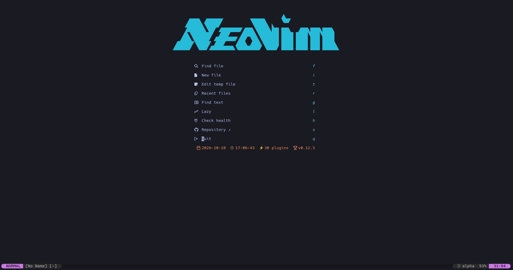

# RigNvim



Go・Python・Rust・C/C++・Web・Terraform の開発と、日本語・Markdown の執筆用 Neovim 設定です。
標準設定の `standard` と、作者が普段使う `author` を選べます。対応言語・基本操作は共通で、AI補完・日本語入力・表示やクリップボードの好みを切り替えられます。

## 導入

### 必要なもの

- Neovim 0.12 以降
- Git、tree-sitter CLI 0.26.1 以降、C コンパイラ（パーサーのビルド用）
- ripgrep（全文検索）、fd（ファイル検索）
- Nerd Font（ターミナルのフォントに設定）
- Node.js / npm、Go（言語サーバーの導入・実行用）
- Deno（日本語入力を使う場合）
- 初回のプラグイン・パーサー・言語サーバー取得用のネットワーク接続

macOS では Homebrew と Command Line Tools を用意し、必要なツールを導入します。

```sh
xcode-select --install
brew install neovim tree-sitter-cli ripgrep fd node go
brew install --cask font-hack-nerd-font
```

Command Line Tools が未導入の場合は、インストール完了後に次へ進んでください。
[dotfiles](https://github.com/runharu0662/dotfiles) の `install.sh` から導入した場合は、設定の配置と上記ツールの導入は済んでいます。

### 設定を配置する

単体で導入する場合は、設定を `~/.config/RigNvim` に配置します。既存の同名ディレクトリがある場合は先に退避してください。

```sh
git clone --branch web https://github.com/runharu0662/RigNvim.git ~/.config/RigNvim
NVIM_APPNAME=RigNvim nvim
```

普段の `nvim` でも使うには、シェル設定（Zsh は `~/.zshrc`、Bash は `~/.bashrc`）に次を追加して、ターミナルを開き直します。dotfiles から導入した場合は設定済みです。

```sh
export NVIM_APPNAME=RigNvim
```

### 初回起動

1. `:Lazy` でプラグインのインストール完了を確認します。
2. パーサーの取得が完了したら、ファイルを開き直します。
3. `:Mason` から必要な言語サーバーだけを導入します。Go は `:LspInstall gopls`、Python は `:LspInstall pyright ruff`、Web 開発は `:LspInstall ts_ls eslint` でも導入できます。完了後にファイルを開き直します。
4. Copilot を使う場合は `:Copilot auth` で認証し、`:Copilot status` で確認します。以降は `<leader>lt` で起動・切り替えできます。

### 好みに合わせて設定する

#### 標準設定で始める

追加の指定がなければ `standard` で起動します。言語サーバーは必要なものだけ導入し、Copilot は `<leader>lt` で必要なときに起動できます。

#### 作者の設定を使う

作者が普段使う設定も `author` プリセットとして同梱しています。どちらも利用者が選べます。

| 設定 | `standard`（既定） | `author`（作者の設定） |
|---|---|---|
| Copilot の自動起動 | 無効 | 有効 |
| SKK 日本語入力 | 無効 | 有効 |
| スクロール演出 | 無効 | 有効 |
| OSとのクリップボード共有 | 無効 | 有効 |
| カーソル行の診断詳細・保存時整形 | 有効 | 有効 |

まず試す場合は次で起動します。Deno と Copilot の認証は別途必要です。

```sh
RIGNVIM_PROFILE=author nvim
```

毎回使うには `lua/config/local.lua` を作成し、次を書いて Neovim を再起動します。このファイルは Git の対象外なので、自分の選択をリポジトリの更新から分けて保存できます。

```lua
return {
  profile = "author",
}
```

#### 個別に調整する

同じ `lua/config/local.lua` に、変更したい項目だけ追加します。たとえば作者の設定を使いつつ、スクロール演出を止める場合は次のようにします。

```lua
return {
  profile = "author",
  smooth_scroll = false,
}
```

指定した項目がプリセットより優先されます。変更後は Neovim を再起動してください。選べる項目と標準設定の値は次のとおりです。

```lua
return {
  profile = "standard",
  copilot = false,           -- true: 挿入モードで自動起動
  japanese_input = false,    -- true: skkeleton を使う（Deno が必要）
  smooth_scroll = false,     -- true: スクロールをアニメーション表示
  system_clipboard = false,  -- true: 通常のヤンク・削除をOSと共有
  diagnostic_details = true, -- true: カーソル行の下に診断詳細を表示
  autoformat = true,         -- false: 保存時整形を初期状態で無効にする
}
```

一度だけプリセットを切り替えて起動することもできます。環境変数はファイル内の `profile` 指定より優先され、個別に指定した項目は維持されます。

```sh
RIGNVIM_PROFILE=author nvim
RIGNVIM_PROFILE=standard nvim
```

保存時整形は `<leader>uf`、診断詳細は `<leader>ud` でも切り替えられます。
共有クリップボードを無効にした状態でも、`"+y` / `"+p` でOSとのコピー・貼り付けができます（クリップボードプロバイダーが必要）。

### 整形・言語ツールを追加する

必要に応じて `:Mason` から `goimports`、`prettier`、`shfmt`、`stylua` などを導入します。`gofmt` は Go、`terraform fmt` は Terraform CLI に含まれます。
Web プロジェクトの Prettier / ESLint は、そのプロジェクトの devDependencies に追加してください。

Python の仮想環境は有効化してから Neovim を起動するか、プロジェクトの Pyright 設定で指定します。
Rust は Rust toolchain と rustfmt が必要です。C/C++ は `compile_commands.json` を用意すると include やコンパイルオプションを解決できます。
Docker 内の依存はホストの LSP から自動では参照されません。Go などのバージョンはプロジェクトの環境に合わせてください。

## 基本の使い方

プロジェクトのディレクトリで `nvim` を起動します。

```sh
cd /path/to/project
nvim
```

Space → f → f でファイル検索、Space → f → g で全文検索、Space → e でファイルツリーを開きます。
保存は Space → w、手動整形は Space → n です。ビルド・テストなどのコマンドはターミナルから実行します。

コードは保存時に利用可能な整形ツールで整形されます。Go は goimports があれば import 整理も行います。
`<leader>uf`（Space → u → f）で現在のバッファの保存時整形を切り替えられます。初期状態は有効で、切り替えはセッション中のみ保持されます。手動整形は無効化中も使えます。
Markdown・MDX は保存時の自動整形を行いません。整形したいときに Space → n を使います。
ESLint の一括修正は `:LspEslintFixAll` またはコードアクションから実行します。

## 対応言語とツール

| 対象 | LSP / diagnostics | 整形 |
|---|---|---|
| Python | Pyright（型チェック basic）、Ruff（構文・lint） | Ruff LSP |
| Rust | rust-analyzer | rust-analyzer（rustfmt が必要） |
| C / C++ | clangd | clangd（clang-format） |
| Go / go.mod / go.sum / go.work | gopls | Go は goimports → gofmt → gopls の優先順、mod / sum は対応する LSP 機能のみ |
| TypeScript / JavaScript / TSX / JSX | ts_ls、ESLint LSP | Prettier、未導入なら対応する LSP |
| HTML / CSS | html / cssls | Prettier、未導入なら対応する LSP |
| JSON / JSONC | jsonls | Prettier、未導入なら jsonls |
| YAML | yamlls | Prettier、未導入なら対応する LSP |
| Terraform / tfvars | terraformls、tflint の言語サーバー | terraform fmt（バッファ内容を標準入力で整形）→ terraformls |
| HCL | Treesitter の構文ハイライト | 一般 HCL に Terraform 整形を強制しない |
| Dockerfile | dockerls | 対応する LSP |
| shell | bashls | shfmt、未導入なら対応する LSP |
| Markdown | Treesitter、日本語入力、記事用コマンド | 明示操作時のみ Prettier |
| 設定用 Lua | lua_ls | StyLua、未導入なら対応する LSP |

## インデント

このリポジトリにも `.editorconfig` を配置しています。基本は2スペース、Python・Rustは4スペース、Go・Makefileはタブです。Luaは既存の `.stylua.toml` に合わせてタブ（表示幅4）を指定しています。

入力時のインデントはプロジェクトの `.editorconfig` を優先します。指定がない場合は Web 系・Markdown・Terraform/HCL はスペース2つ、Go・Make はタブ、それ以外はスペース4つです。
`.prettierrc` や `.stylua.toml` だけでは入力時の幅は連動しないため、入力と整形を揃えるには `.editorconfig` にも同じインデント規則を指定してください。変更後はファイルを開き直すと反映されます。

プロジェクトのルート（`package.json` などと同じ場所）に `.editorconfig` を作成します。以下は基本を2スペース、Python・Rustを4スペース、Go・Makefileをタブにする例です。既存の設定がある場合は、そのプロジェクトの規則に合わせてください。

```ini
root = true

[*]
indent_style = space
indent_size = 2

[*.py]
indent_size = 4

[*.rs]
indent_size = 4

[*.go]
indent_style = tab
indent_size = tab
tab_width = 4

[Makefile]
indent_style = tab
indent_size = tab
tab_width = 4
```

Prettier を使う場合は、`.prettierrc` のインデント設定も揃えます。

```json
{
  "tabWidth": 2,
  "useTabs": false
}
```

## カスタムキーマップ

`<leader>` は Space、`<C-x>` は Ctrl + x です。たとえば `<leader>ff` は Space → f → f の順に押します。
以下はこの構成で追加・変更しているキーマップです。モードの指定がないものはノーマルモードで使います。

### プリセットとキーの関係

基本のマッピングは `standard`・`author` で共通です。プリセットは機能の初期状態を変え、キーの配置は変えません。

| 操作 | `standard` | `author` |
|---|---|---|
| 検索・ウィンドウ移動・LSP・Git・手動整形 | 下記の共通キーマップ | 同じ |
| `<leader>lt` | Copilot を起動し、以降は切り替え | 自動起動する Copilot の有効・無効を切り替え |
| 挿入モードの `<C-l>` | Copilot 起動後、提案全体を採用 | Copilot の提案全体を採用 |
| 挿入・コマンドラインの `<C-j>` | Neovim 標準の操作 | SKK の切り替え（Deno が必要） |
| `<leader>uf` / `<leader>ud` | 保存時整形 / 診断詳細を切り替え | 同じ |

`japanese_input` などを個別に設定した場合は、その有効・無効に従います。
`<C-j>` はノーマルモードでは下のウィンドウへ移動し、SKK 有効時の挿入・コマンドラインモードでは日本語入力を切り替えます。
標準の `f` / `F` / `t` / `T` と `grr` / `grn` / `gra` を維持し、Tab の補完確定や Copilot による `<C-x>` の上書きは行いません。

### ファイル・ウィンドウ・検索

| キー | 操作 |
|---|---|
| `<leader>w` | 保存（ノーマル・ビジュアル） |
| `<leader>q` | 現在のウィンドウを閉じる（ノーマル・ビジュアル） |
| `<leader>Q` | 全バッファを保存して終了（ノーマル・ビジュアル） |
| `<leader>v` | 右側に縦分割 |
| `<C-h>` / `<C-j>` / `<C-k>` / `<C-l>` | 左 / 下 / 上 / 右のウィンドウへ移動 |
| `<leader>bc` | 現在のバッファを閉じる |
| `<leader>e` | Neo-tree の表示を切り替える |
| `l` / `h` | Neo-tree 内でファイル・ノードを開く / ノードを閉じる |
| `<leader>ff` | ファイル検索 |
| `<leader>fg` | プロジェクト内の全文検索 |
| `<leader>fb` | バッファ検索 |
| `<leader>fh` | ヘルプ検索 |
| `<leader>fn` | 通知履歴を検索 |
| `<leader>,` | スタート画面を開く |
| `<leader>?` | 現在のバッファのローカルキーマップを表示 |
| `<leader>i` | FIFO inbox を開く（`:VimboxOpen`） |

### コード・診断・Git・ジャンプ

| キー | 操作 |
|---|---|
| `<leader>n` | 手動整形（整形先を一つ選択。Markdown も対象） |
| `<leader>uf` | 現在のバッファの保存時整形を切り替える |
| `<leader>rn` | LSP でシンボル名を変更 |
| `<leader>ca` | LSP のコードアクション |
| `gd` | 定義へ移動（LSP 接続時、既存の割り当てがなければ追加） |
| `<leader>cd` | カーソル行の診断をポップアップ表示 |
| `<leader>fd` | ワークスペースの診断を検索 |
| `<leader>cl` | 現在のバッファの診断一覧を開く |
| `<leader>ud` | カーソル行の下の診断詳細表示を切り替える |
| `<leader>ci` | 言語サーバーの導入・接続状況を表示 |
| `<leader>gd` | カーソル位置の Git 差分を部分表示 |
| `<leader>gl` | 現在のバッファと Git index を比較 |
| `<leader>hw` | 単語へ Hop ジャンプ |
| `<leader>hl` | 行へ Hop ジャンプ |
| `<leader>hc` | 1文字を指定して Hop ジャンプ |
| `<leader>hp` | パターンを指定して Hop ジャンプ |

Go / TS の import 整理は `:OrganizeImports`（該当 LSP 接続時）、ESLint の一括修正は `:LspEslintFixAll` またはコードアクションから実行できます。
Neovim 標準の LSP 操作も使えます。`grr` は参照、`grn` は名前変更、`gra` はコードアクションです。

### 補完・Copilot・日本語入力

| キー | モード・条件 | 操作 |
|---|---|---|
| `<C-p>` / `<C-n>` | 挿入・補完メニュー表示中 | 前 / 次の補完候補 |
| `<CR>` | 挿入・補完メニュー表示中 | 選択済みの候補を確定 |
| `<leader>lt` | ノーマル | Copilot を起動し、以降は有効・無効を切り替える |
| `<C-l>` | 挿入・Copilot 提案表示中 | 提案全体を採用 |
| `<C-j>` | 挿入・コマンドライン（SKK 有効・Deno 導入時） | 日本語入力を切り替える |
| `<C-n>` / `<C-p>` | skkeleton 変換中 | 次 / 前の変換候補 |
| `<C-y>` / `<C-e>` | skkeleton 変換中 | 確定 / キャンセル |

nvim-cmp は Markdown と skkeleton の日本語入力中には無効です。
Tab は補完確定に割り当てず、候補を選択して Enter で確定します。
Copilot の提案は補完メニュー表示中には隠れます。Esc で挿入モードを抜けると提案を閉じられます。

### Markdown・スタート画面

| キー | 条件 | 操作 |
|---|---|---|
| `j` / `k` | Markdown・ノーマル / ビジュアル | 表示行で上下移動（回数指定時はファイルの行単位） |
| `f` / `i` / `r` | スタート画面 | ファイル検索 / 新規ファイル / 最近のファイル |
| `g` / `l` / `h` / `q` | スタート画面 | 全文検索 / Lazy / ヘルスチェック / 終了 |
| `s` | スタート画面 | RigNvim の GitHub リポジトリを既定のブラウザで開く |

## 日本語入力

Deno を導入し、`lua/config/local.lua` で `profile = "author"` または `japanese_input = true` を設定して Neovim を再起動すると、挿入・コマンドラインモードの `<C-j>` で skkeleton を切り替えられます。

```sh
brew install deno
```

日本語入力を有効にしない場合は、標準の `<C-j>` の操作を維持します。
変換中は `<C-n>` / `<C-p>` で候補移動、`<C-y>` で確定、`<C-e>` でキャンセルします。SKK 辞書は同梱されています。

別の辞書を使う場合は `init.lua` に指定します。

```lua
vim.g.skk_dictionary_path = vim.fn.expand("~/path/to/SKK-JISYO.L")
```

## Markdown

Markdown は画面幅で折り返して表示します。表示の折り返しでファイルに改行は挿入されません。
nvim-cmp は無効です。Copilot を使う場合は `<leader>lt` で起動できます。

## Inbox

`<leader>i` で [Vimbox](https://github.com/runharu0662/vimbox) を開きます。入力欄で Enter を押して項目を追加し、Tab で一覧へ移動します。
一覧の `d` で先頭の項目を処理済みにします。

## 困ったとき

| 症状 | 確認・操作 |
|---|---|
| ハイライトやインデントが効かない | `tree-sitter --version` を確認し、パーサー取得後にファイルを開き直す |
| 補完・診断が出ない | `<leader>ci`（`:LanguageStatus`）で `missing` / `installed, not attached` / `attached` を確認する |
| 言語サーバーの導入に失敗する | `:Mason` でエラーを確認し、`:LspInstall gopls` などで再試行する |
| 整形できない | `:Mason` とプロジェクトの整形ツール導入状況を確認し、`<leader>n` を実行する |
| 日本語入力を切り替えられない | `japanese_input = true`、`deno --version` と `:Lazy` の skkeleton / denops.vim を確認し、再起動する |
| アイコンが崩れる | ターミナルのフォントを Nerd Font に設定する |
| 起動時にエラーが出る | `:messages` と `:checkhealth` を確認する |

診断は `]d` / `[d` で移動し、`<leader>cd` で詳細を表示できます。`<leader>fd` はワークスペース、`<leader>cl` は現在のバッファの診断一覧です。

## 更新

設定ディレクトリで実行します。ローカル変更がある場合は先にコミットまたは退避してください。

```sh
cd ~/.config/RigNvim
git pull --ff-only
```

Neovim を再起動し、`:Lazy sync` でプラグインを更新します。dotfiles から導入した場合は、dotfiles 側の更新手順を使ってください。

変更履歴は [CHANGELOG.md](CHANGELOG.md)、開発者向けの検証手順は [docs/development.md](docs/development.md) を参照してください。
